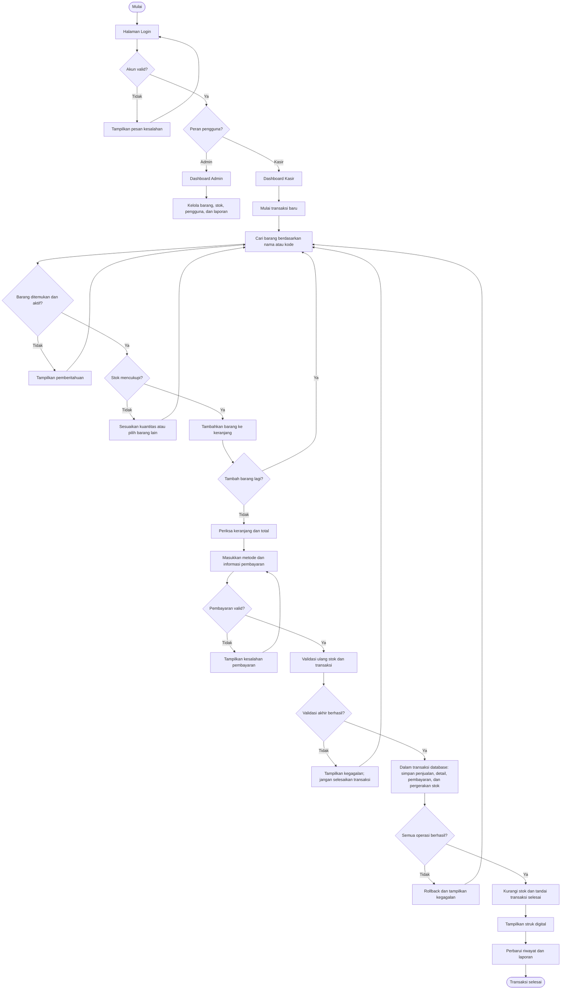
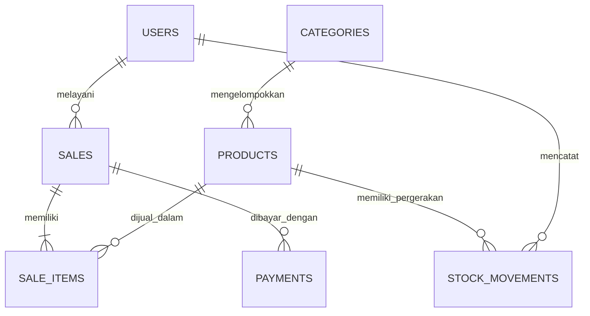

# Rancangan Aplikasi Point of Sale (POS)

> **Versi dokumen:** 1.0  
> **Jenis aplikasi:** Web-based Point of Sale  
> **Ruang lingkup awal:** Satu toko, dengan peran Admin dan Kasir  
> **Perangkat tambahan:** Tidak diwajibkan; aplikasi dapat dioperasikan menggunakan browser, keyboard, dan mouse.  
> **Bukti transaksi:** Struk digital yang ditampilkan di layar.

---

## 1. Gambaran Umum

Point of Sale (POS) adalah aplikasi untuk membantu proses penjualan di toko. Aplikasi ini mengelola data barang, kategori, stok, transaksi penjualan, pembayaran, riwayat transaksi, serta laporan penjualan.

Aplikasi dirancang berbasis web sehingga pengguna mengaksesnya melalui browser. Kasir tidak diwajibkan menggunakan barcode scanner atau perangkat kasir khusus. Barang dapat dicari berdasarkan nama, kode barang, atau kategori, lalu dimasukkan ke keranjang belanja.

### 1.1 Tujuan

1. Mempermudah pencatatan transaksi penjualan.
2. Mengurangi kesalahan perhitungan total belanja dan kembalian.
3. Mengelola stok barang berdasarkan transaksi dan penyesuaian yang tercatat.
4. Menyimpan riwayat transaksi secara terstruktur.
5. Menyediakan laporan untuk membantu pemilik atau admin memantau penjualan.
6. Memisahkan hak akses Admin dan Kasir.

### 1.2 Asumsi dan Batasan Versi Awal

- Aplikasi digunakan untuk satu toko.
- Terdapat dua peran utama: Admin dan Kasir.
- Aplikasi berjalan melalui browser.
- Penggunaan barcode scanner, printer thermal, laci uang, dan perangkat keras tambahan tidak menjadi persyaratan.
- Pencarian barang dilakukan melalui kolom pencarian, kode barang, nama, atau kategori.
- Struk ditampilkan sebagai struk digital dan dapat dibuka kembali dari riwayat transaksi.
- Pembayaran tunai menjadi metode pembayaran utama pada versi awal.
- Pembayaran QRIS atau transfer dapat dicatat setelah statusnya diverifikasi. Integrasi payment gateway tidak termasuk dalam ruang lingkup awal.
- Mode offline penuh dan sinkronisasi antarbeberapa perangkat belum menjadi bagian versi awal; kebutuhan tersebut harus dirancang khusus jika diperlukan.

---

## 2. Teknologi yang Direkomendasikan

| Komponen | Teknologi | Kegunaan |
|---|---|---|
| Frontend | HTML, CSS, JavaScript | Membuat tampilan dan interaksi aplikasi. |
| Framework tampilan | Bootstrap atau Tailwind CSS | Membantu membuat antarmuka responsif. Pilih salah satu. |
| Backend | PHP dengan Laravel | Mengatur autentikasi, transaksi, validasi, stok, dan laporan. |
| Database | MySQL | Menyimpan data pengguna, barang, stok, pembayaran, dan transaksi. |
| Lingkungan pengembangan | Laragon atau XAMPP | Menjalankan PHP dan MySQL secara lokal selama pengembangan. |
| Editor kode | Visual Studio Code atau Cursor | Menulis dan mengelola kode. |
| Akses aplikasi | Browser pada laptop atau komputer | Menjalankan aplikasi tanpa perangkat kasir khusus. |

**Rekomendasi:** Laravel + MySQL + HTML/CSS/JavaScript. Untuk menjaga konsistensi dan keamanan, perhitungan harga, diskon, total, pembayaran, dan perubahan stok tetap divalidasi oleh backend, bukan hanya oleh browser.

---

## 3. Peran dan Hak Akses

### 3.1 Admin

Admin mengelola data utama dan memantau kegiatan toko.

Hak akses Admin:

- Melihat dashboard toko.
- Mengelola data barang dan kategori.
- Mengelola stok dan melihat riwayat pergerakan stok.
- Melihat seluruh transaksi dan detail transaksi.
- Melihat laporan penjualan.
- Membuat, mengubah, mengaktifkan, atau menonaktifkan akun Kasir.
- Mengatur informasi toko dan konfigurasi aplikasi.
- Melakukan penyesuaian stok dengan alasan yang tercatat.

### 3.2 Kasir

Kasir berfokus pada pelayanan transaksi.

Hak akses Kasir:

- Melihat dashboard kasir.
- Membuat transaksi baru.
- Mencari dan memilih barang.
- Mengubah jumlah atau menghapus barang selama transaksi belum diselesaikan.
- Memilih metode pembayaran yang diizinkan.
- Memasukkan jumlah uang yang dibayar untuk transaksi tunai.
- Menyelesaikan transaksi setelah pembayaran tervalidasi.
- Melihat dan membuka kembali struk digital dari transaksi yang menjadi hak aksesnya, sesuai kebijakan toko.
- Melihat atau memperbarui profil sendiri jika fitur profil diaktifkan.

### 3.3 Pembatasan Hak Akses

- Kasir tidak boleh mengelola akun pengguna atau konfigurasi utama toko.
- Perubahan harga dan penyesuaian stok dibatasi untuk Admin, kecuali kebijakan toko secara eksplisit memberi izin tertentu kepada Kasir.
- Transaksi yang sudah selesai tidak boleh diubah langsung. Koreksi dilakukan melalui prosedur retur atau pembatalan yang tercatat, jika fitur tersebut tersedia.
- Setiap transaksi mencatat pengguna yang melayaninya.

---

## 4. Struktur Menu

### 4.1 Menu Admin

1. Dashboard
2. Data Barang
3. Kategori Barang
4. Stok dan Pergerakan Stok
5. Transaksi dan Riwayat Transaksi
6. Laporan Penjualan
7. Manajemen Pengguna
8. Pengaturan Toko
9. Profil
10. Keluar

### 4.2 Menu Kasir

1. Dashboard Kasir
2. Transaksi Penjualan
3. Riwayat Transaksi
4. Profil
5. Keluar

Menu yang ditampilkan harus disesuaikan dengan peran pengguna yang sedang login.

---

## 5. Rincian Fitur

### 5.1 Login dan Autentikasi

**Fungsi:** Memastikan hanya pengguna yang terdaftar dapat mengakses aplikasi.

Alur:

1. Pengguna membuka aplikasi.
2. Sistem menampilkan halaman login.
3. Pengguna mengisi username/email dan password.
4. Backend memvalidasi data login.
5. Jika valid, sistem mengarahkan pengguna ke dashboard sesuai peran.
6. Jika tidak valid, sistem menampilkan pesan kesalahan tanpa membocorkan informasi sensitif.
7. Pengguna dapat keluar melalui menu Logout.

Persyaratan:

- Password disimpan dalam bentuk hash, bukan teks biasa.
- Halaman dan endpoint dibatasi berdasarkan peran.
- Sesi pengguna dikelola dengan aman.

### 5.2 Dashboard

Dashboard Admin menampilkan:

- Total penjualan untuk periode yang dipilih, dengan default hari ini.
- Jumlah transaksi selesai.
- Jumlah barang aktif.
- Daftar barang dengan stok menipis.
- Produk terlaris pada periode yang dipilih.
- Ringkasan transaksi terbaru.

Dashboard Kasir menampilkan:

- Tombol atau pintasan untuk memulai transaksi baru.
- Ringkasan transaksi kasir pada hari berjalan.
- Riwayat transaksi terbaru yang boleh diakses kasir.

Nilai dashboard dihitung dari data transaksi yang berstatus selesai dan tidak dibatalkan.

### 5.3 Manajemen Kategori

Fungsi:

- Menambah kategori.
- Melihat daftar kategori.
- Mengubah nama atau deskripsi kategori.
- Menonaktifkan kategori yang tidak digunakan.

Validasi:

- Nama kategori wajib diisi.
- Nama kategori harus memenuhi aturan keunikan yang ditetapkan.
- Kategori yang masih digunakan oleh barang sebaiknya dinonaktifkan, bukan dihapus permanen.

### 5.4 Manajemen Barang

Informasi barang yang disarankan:

| Field | Wajib? | Keterangan |
|---|---|---|
| ID barang | Otomatis | Identitas internal database. |
| Kode barang/SKU | Ya | Kode internal untuk pencarian manual; unik. |
| Nama barang | Ya | Nama yang ditampilkan kepada kasir. |
| Kategori | Disarankan | Kategori barang. |
| Harga beli | Ya untuk pelaporan laba | Harga perolehan per satuan. |
| Harga jual | Ya | Harga jual per satuan. |
| Stok saat ini | Ya | Jumlah stok yang tersedia. |
| Stok minimum | Opsional | Ambang untuk pemberitahuan stok menipis. |
| Satuan | Disarankan | Misalnya pcs, botol, kg, atau pak. |
| Status | Ya | Aktif atau tidak aktif. |
| Waktu dibuat/diubah | Otomatis | Untuk kebutuhan audit. |

Fungsi:

- Menambah barang.
- Melihat dan mencari barang.
- Mengubah informasi barang.
- Menonaktifkan barang.
- Menyaring daftar berdasarkan kategori dan status.

Aturan:

- Kode barang harus unik.
- Harga dan stok tidak boleh bernilai negatif.
- Barang tidak aktif tidak dapat ditambahkan ke transaksi baru.
- Barang yang sudah pernah muncul dalam transaksi sebaiknya dinonaktifkan daripada dihapus permanen.
- Harga jual dan nama barang pada detail transaksi disimpan sebagai snapshot agar riwayat lama tidak berubah ketika data barang diperbarui.

### 5.5 Manajemen Stok

Stok berubah melalui kegiatan yang tercatat, antara lain:

- Stok awal saat barang didaftarkan.
- Penambahan stok.
- Penyesuaian stok setelah pemeriksaan fisik.
- Barang rusak atau hilang.
- Penjualan.
- Retur, bila modul retur tersedia.

Setiap pergerakan stok sebaiknya mencatat:

- Barang yang berubah.
- Jenis pergerakan (masuk, keluar, atau penyesuaian).
- Jumlah perubahan.
- Stok sebelum dan sesudah perubahan, atau nilai perubahan yang dapat direkonsiliasi.
- Alasan perubahan.
- Waktu pencatatan.
- Pengguna yang mencatat.
- Referensi transaksi jika perubahan berkaitan dengan penjualan.

**Penting:** stok penjualan dikurangi hanya ketika transaksi berhasil diselesaikan, bukan ketika barang baru ditambahkan ke keranjang.

### 5.6 Transaksi Penjualan

Fungsi:

- Memulai transaksi baru.
- Mencari barang menggunakan nama atau kode barang.
- Memilih barang dari hasil pencarian.
- Menambah, mengurangi, atau menghapus barang di keranjang.
- Mengubah kuantitas sebelum checkout.
- Menghitung subtotal dan total otomatis.
- Memproses pembayaran.
- Menyimpan transaksi selesai.
- Menampilkan struk digital.

Komponen halaman transaksi:

1. Kolom pencarian barang.
2. Daftar hasil pencarian.
3. Keranjang belanja.
4. Kontrol kuantitas.
5. Subtotal per barang.
6. Ringkasan total.
7. Pilihan metode pembayaran.
8. Input jumlah bayar untuk pembayaran tunai.
9. Nilai kembalian.
10. Tombol proses pembayaran dan batalkan transaksi yang belum diselesaikan.

### 5.7 Pembayaran

Metode pada versi awal:

- Tunai.
- Pembayaran lain yang dicatat manual setelah diverifikasi, apabila diperlukan toko.

Rumus dasar:

- **Subtotal item = Harga satuan × Kuantitas**
- **Total transaksi = Jumlah subtotal − Diskon + Biaya tambahan yang berlaku**
- **Kembalian tunai = Jumlah uang diterima − Total transaksi**

Pada versi awal, jika fitur diskon atau biaya tambahan belum dibuat, total transaksi cukup berupa penjumlahan semua subtotal.

Validasi pembayaran tunai:

- Total transaksi harus lebih besar dari atau sama dengan nol dan dihitung ulang oleh backend.
- Uang yang diterima harus sama dengan atau lebih besar daripada total transaksi.
- Jika uang kurang, transaksi tidak dapat diselesaikan.
- Kembalian tidak boleh negatif.

Pembayaran digital:

- Jika belum terintegrasi dengan penyedia pembayaran, status pembayaran digital harus diverifikasi oleh pengguna yang berwenang sebelum transaksi dinyatakan selesai.
- Menekan tombol konfirmasi saja tidak membuktikan bahwa pembayaran telah diterima.

### 5.8 Penyelesaian dan Penyimpanan Transaksi

Ketika pembayaran valid, sistem harus menjalankan satu rangkaian operasi yang konsisten:

1. Memeriksa kembali status barang, harga yang berlaku, dan stok terbaru.
2. Memastikan jumlah stok mencukupi untuk seluruh detail transaksi.
3. Membuat catatan transaksi utama.
4. Menyimpan setiap detail barang yang dijual beserta harga satuan saat itu dan kuantitasnya.
5. Menyimpan catatan pembayaran.
6. Mengurangi stok sesuai jumlah terjual.
7. Mencatat pergerakan stok yang berkaitan dengan transaksi.
8. Menandai transaksi sebagai selesai.

Operasi tersebut harus menggunakan transaksi database (*database transaction*) agar seluruh perubahan berhasil bersama-sama atau seluruhnya dibatalkan jika terjadi kegagalan. Backend juga harus mencegah transaksi yang sama diproses dua kali akibat pengiriman permintaan berulang.

### 5.9 Struk Digital

Struk digital ditampilkan setelah transaksi berhasil. Struk setidaknya memuat:

- Nama dan informasi toko.
- Nomor transaksi.
- Tanggal dan waktu transaksi.
- Nama atau identitas kasir.
- Daftar nama barang.
- Kuantitas, harga satuan, dan subtotal.
- Diskon atau biaya tambahan jika digunakan.
- Total transaksi.
- Metode dan jumlah pembayaran.
- Jumlah uang diterima serta kembalian untuk transaksi tunai.
- Status transaksi.

Struk dapat dilihat kembali melalui riwayat transaksi. Fitur unduh PDF atau cetak melalui fungsi browser dapat ditambahkan, tetapi printer fisik tidak menjadi persyaratan.

### 5.10 Riwayat Transaksi

Fungsi:

- Menampilkan daftar transaksi.
- Mencari berdasarkan nomor transaksi.
- Menyaring berdasarkan tanggal, kasir, metode pembayaran, dan status.
- Membuka detail transaksi dan struk digital.

Daftar minimal menampilkan nomor transaksi, tanggal/waktu, kasir, total, metode pembayaran, dan status.

Transaksi selesai tidak boleh diedit langsung. Jika kelak diperlukan koreksi, proses retur atau pembatalan harus dibuat dengan catatan audit dan penyesuaian stok yang sesuai.

### 5.11 Laporan Penjualan

Laporan dasar:

- Penjualan harian.
- Penjualan berdasarkan rentang tanggal.
- Jumlah transaksi selesai.
- Total penjualan/omzet.
- Ringkasan penjualan per metode pembayaran.
- Produk terlaris berdasarkan kuantitas.
- Ringkasan stok dan barang yang menipis.

Ketentuan:

- Laporan penjualan hanya menghitung transaksi sesuai status yang ditetapkan, misalnya selesai dan tidak dibatalkan.
- Omzet tidak sama dengan laba bersih.
- Untuk memperkirakan laba kotor, aplikasi perlu menyimpan harga beli atau harga pokok pada detail penjualan dan menggunakan metode perhitungan yang konsisten.
- Retur, diskon, dan biaya tambahan harus diperhitungkan secara konsisten jika modul terkait ditambahkan.

### 5.12 Manajemen Pengguna

Fungsi Admin:

- Membuat akun Kasir.
- Mengubah nama dan informasi akun.
- Mengatur peran.
- Mengaktifkan atau menonaktifkan akun.
- Mereset akses sesuai prosedur yang aman.

Akun yang telah digunakan dalam transaksi tidak dihapus permanen; akun tersebut dinonaktifkan agar jejak transaksi tetap dapat ditelusuri.

### 5.13 Pengaturan Toko

Pengaturan yang dapat disediakan:

- Nama toko.
- Alamat dan informasi kontak.
- Teks pada struk digital.
- Format nomor transaksi.
- Ambang notifikasi stok menipis.
- Metode pembayaran yang diaktifkan.

---

## 6. Alur Kerja Aplikasi

### 6.1 Alur Login

1. Pengguna membuka aplikasi.
2. Sistem menampilkan halaman login.
3. Pengguna memasukkan username/email dan password.
4. Sistem memvalidasi kredensial.
5. Jika valid, sistem memeriksa peran pengguna.
6. Pengguna diarahkan ke dashboard sesuai perannya.
7. Jika tidak valid, sistem menampilkan pesan kesalahan dan tetap berada pada halaman login.

### 6.2 Alur Persiapan Data Barang

1. Admin login.
2. Admin membuka menu Kategori dan membuat kategori yang diperlukan.
3. Admin membuka menu Data Barang.
4. Admin mengisi kode barang, nama, kategori, harga, satuan, dan stok awal.
5. Sistem memvalidasi data dan memastikan kode barang belum digunakan.
6. Sistem menyimpan data barang.
7. Barang aktif tersedia untuk pencarian pada halaman transaksi.

### 6.3 Alur Transaksi Penjualan

1. Kasir login dan membuka menu Transaksi Penjualan.
2. Kasir memulai transaksi baru.
3. Kasir mencari barang berdasarkan nama atau kode.
4. Sistem menampilkan hasil pencarian dari database.
5. Kasir memilih barang dan memasukkan kuantitas.
6. Sistem memeriksa status barang dan ketersediaan stok.
7. Sistem menambahkan barang ke keranjang dan menghitung subtotal.
8. Kasir mengulangi pencarian jika ada barang tambahan.
9. Kasir memeriksa keranjang dan total belanja.
10. Kasir melanjutkan ke pembayaran.
11. Sistem meminta metode pembayaran dan informasi yang diperlukan.
12. Sistem memvalidasi pembayaran.
13. Jika pembayaran tidak valid, sistem menampilkan alasan dan meminta perbaikan.
14. Jika valid, backend memvalidasi ulang stok dan menyimpan transaksi serta detail pembayaran secara konsisten.
15. Sistem memperbarui stok dan mencatat pergerakan stok.
16. Sistem menampilkan konfirmasi transaksi berhasil dan struk digital.
17. Transaksi muncul pada riwayat dan masuk ke perhitungan laporan.
18. Kasir dapat memulai transaksi berikutnya.

### 6.4 Alur Barang Tidak Ditemukan

1. Kasir memasukkan kata pencarian atau kode barang.
2. Sistem mencari barang aktif.
3. Jika tidak ditemukan, sistem menampilkan pemberitahuan bahwa barang belum terdaftar.
4. Barang tidak boleh ditambahkan ke transaksi sebagai barang valid.
5. Kasir dapat memilih barang lain atau meminta Admin mendaftarkan barang tersebut.

### 6.5 Alur Stok Tidak Mencukupi

1. Kasir menambahkan barang atau mengubah kuantitas.
2. Sistem memeriksa stok yang tersedia.
3. Jika stok tidak cukup, sistem menolak kuantitas yang melebihi stok dan menjelaskan batas yang tersedia.
4. Kasir mengurangi kuantitas atau meminta Admin melakukan penyesuaian stok yang sah.
5. Pada saat checkout, backend memeriksa ulang stok untuk menghindari konflik jika ada penjualan lain.

### 6.6 Alur Pembayaran Tidak Valid

1. Kasir memilih metode pembayaran.
2. Sistem menghitung total dari data keranjang yang telah divalidasi.
3. Untuk tunai, kasir memasukkan jumlah uang yang diterima.
4. Jika jumlah uang kurang dari total, tombol penyelesaian transaksi ditolak atau sistem meminta perbaikan.
5. Setelah pembayaran valid, sistem melanjutkan penyimpanan transaksi.

### 6.7 Alur Laporan

1. Admin membuka menu Laporan Penjualan.
2. Admin memilih tanggal atau rentang periode.
3. Sistem mengambil data transaksi berdasarkan status yang diperhitungkan.
4. Sistem menghitung ringkasan penjualan dan statistik barang.
5. Sistem menampilkan hasil dalam bentuk ringkasan dan tabel.
6. Jika tersedia, Admin dapat mengekspor laporan ke CSV atau Excel.

---

## 7. Flowchart Utama

Diagram berikut menggunakan sintaks Mermaid dan dapat ditampilkan pada editor Markdown yang mendukung Mermaid.

---

## 8. Rancangan Database Awal

Berikut struktur tabel konseptual untuk versi awal. Detail tipe data, indeks, foreign key, dan nama kolom final perlu ditetapkan ketika implementasi dimulai.

### 8.1 Tabel `users`

Menyimpan akun pengguna.

Kolom yang disarankan:

- `id`
- `name`
- `username` atau `email` (unik)
- `password`
- `role` (admin/kasir)
- `is_active`
- `created_at`
- `updated_at`

### 8.2 Tabel `categories`

Menyimpan kategori barang.

- `id`
- `name`
- `description` (opsional)
- `is_active`
- `created_at`
- `updated_at`

### 8.3 Tabel `products`

Menyimpan informasi barang dan stok terkini.

- `id`
- `category_id` (dapat kosong jika kategori tidak diwajibkan)
- `sku` (kode barang, unik)
- `name`
- `unit`
- `purchase_price`
- `selling_price`
- `stock`
- `minimum_stock` (opsional)
- `is_active`
- `created_at`
- `updated_at`

Stok terkini dapat disimpan di `products.stock` untuk akses cepat, tetapi perubahan stok harus selalu disertai catatan pada tabel `stock_movements`.

### 8.4 Tabel `sales`

Menyimpan informasi utama transaksi.

- `id`
- `transaction_number` (unik)
- `user_id` (kasir yang melayani)
- `transaction_date`
- `subtotal`
- `discount_amount`
- `total_amount`
- `status` (misalnya pending/completed/cancelled, sesuai desain akhir)
- `notes` (opsional)
- `created_at`
- `updated_at`

### 8.5 Tabel `sale_items`

Menyimpan rincian barang pada setiap transaksi.

- `id`
- `sale_id`
- `product_id`
- `product_name_snapshot`
- `sku_snapshot`
- `quantity`
- `unit_price`
- `unit_purchase_price` atau snapshot harga pokok jika laporan laba diperlukan
- `discount_amount` (opsional)
- `line_total`
- `created_at`
- `updated_at`

Snapshot nama, kode, harga jual, dan bila perlu harga pokok mencegah perubahan data barang saat ini mengubah riwayat transaksi masa lalu.

### 8.6 Tabel `payments`

Menyimpan pembayaran untuk transaksi.

- `id`
- `sale_id`
- `method` (cash, transfer, qris, atau nilai yang diizinkan)
- `amount_tendered` (uang diterima jika relevan)
- `amount_paid`
- `change_amount`
- `status` (pending/verified/paid/failed sesuai metode dan alur)
- `reference_number` (opsional)
- `verified_by` (opsional)
- `paid_at` (opsional)
- `created_at`
- `updated_at`

Untuk versi tunai sederhana, struktur dapat dibuat lebih ringkas. Status dan kolom pembayaran digital perlu ditentukan lagi jika integrasi elektronik dikembangkan.

### 8.7 Tabel `stock_movements`

Menyimpan perubahan stok.

- `id`
- `product_id`
- `user_id`
- `movement_type` (initial, purchase_in, sale_out, adjustment, damaged, return, dan nilai lain yang ditetapkan)
- `quantity_change` (positif untuk penambahan, negatif untuk pengurangan)
- `stock_before` (opsional)
- `stock_after` (opsional)
- `reference_type` (opsional)
- `reference_id` (opsional)
- `reason` (opsional tetapi dianjurkan untuk penyesuaian)
- `created_at`

### 8.8 Hubungan Antar Tabel

- Satu kategori dapat memiliki banyak barang.
- Satu kasir dapat melayani banyak transaksi.
- Satu transaksi memiliki banyak detail barang.
- Satu barang dapat muncul pada banyak detail transaksi.
- Satu transaksi memiliki catatan pembayaran; rancangan dapat mendukung beberapa pembayaran jika diperlukan.
- Satu barang memiliki banyak catatan pergerakan stok.
- Catatan pergerakan stok dapat merujuk pada transaksi penjualan.

---

## 9. Aturan Bisnis dan Validasi

1. Hanya pengguna aktif yang dapat login.
2. Halaman dan proses backend wajib memeriksa hak akses pengguna.
3. Kode barang harus unik.
4. Harga, kuantitas, dan nilai stok tidak boleh negatif.
5. Hanya barang aktif yang dapat dijual.
6. Kuantitas pada item transaksi harus lebih besar dari nol.
7. Stok yang tersedia harus mencukupi sebelum transaksi selesai.
8. Harga dan total dihitung atau divalidasi ulang oleh backend; backend tidak boleh mempercayai total yang dikirim browser.
9. Transaksi tunai hanya dapat selesai jika uang yang diterima minimal sama dengan total pembayaran.
10. Transaksi selesai dan pengurangan stok harus disimpan secara konsisten dalam satu transaksi database.
11. Pengulangan permintaan checkout tidak boleh membuat transaksi ganda.
12. Setiap transaksi memiliki nomor transaksi yang unik.
13. Transaksi yang selesai tidak dihapus atau diedit langsung.
14. Penyesuaian stok harus mencatat alasan dan pengguna yang melakukannya.
15. Akun pengguna yang telah terkait transaksi dinonaktifkan, bukan dihapus permanen.
16. Laporan harus menggunakan definisi status transaksi yang konsisten.
17. Informasi sensitif seperti password tidak ditampilkan dalam halaman, log, atau laporan.
18. Transaksi yang gagal tidak boleh menyebabkan stok berkurang.

---

## 10. Keamanan dan Keandalan

- Gunakan hashing password melalui mekanisme yang direkomendasikan framework.
- Validasi masukan di backend, termasuk harga, stok, jumlah, dan metode pembayaran.
- Gunakan perlindungan CSRF dan mekanisme autentikasi bawaan Laravel sesuai kebutuhan aplikasi.
- Terapkan otorisasi berdasarkan peran pada sisi backend, bukan hanya menyembunyikan menu di antarmuka.
- Gunakan foreign key, indeks, dan batasan keunikan pada database.
- Gunakan transaksi database untuk penyelesaian penjualan dan perubahan stok.
- Lakukan pencatatan perubahan stok dan tindakan penting pengguna.
- Siapkan prosedur backup database dan uji pemulihan data.
- Hindari menyimpan informasi pembayaran yang tidak diperlukan.
- Pastikan kesalahan teknis tidak mengungkap konfigurasi server atau informasi sensitif kepada pengguna.

---

## 11. Rencana Tahapan Pengembangan

### Tahap 1 — Analisis dan Perancangan

- Menetapkan kebutuhan toko dan batasan aplikasi.
- Menetapkan peran Admin dan Kasir.
- Membuat use case, flowchart, rancangan antarmuka, dan ERD.
- Menentukan aturan transaksi, stok, dan pembayaran.

**Hasil:** dokumen kebutuhan dan rancangan sistem.

### Tahap 2 — Persiapan Proyek

- Menyiapkan PHP, Composer, Laravel, dan MySQL.
- Membuat proyek dan konfigurasi lingkungan.
- Menyiapkan struktur dasar layout dan navigasi.

**Hasil:** aplikasi dasar dapat berjalan di lingkungan pengembangan.

### Tahap 3 — Autentikasi dan Hak Akses

- Membuat login dan logout.
- Membuat peran Admin dan Kasir.
- Membatasi rute dan tindakan sesuai peran.

**Hasil:** pengguna diarahkan ke dashboard yang benar.

### Tahap 4 — Kategori, Barang, dan Stok

- Membuat CRUD kategori dan barang.
- Membuat validasi kode barang unik.
- Membuat pencatatan stok awal dan penyesuaian stok.
- Membuat riwayat pergerakan stok.

**Hasil:** data barang siap digunakan pada transaksi.

### Tahap 5 — Transaksi Penjualan

- Membuat pencarian barang tanpa scanner.
- Membuat keranjang belanja.
- Membuat validasi kuantitas dan stok.
- Membuat perhitungan subtotal dan total.

**Hasil:** pengguna dapat menyusun transaksi sebelum pembayaran.

### Tahap 6 — Pembayaran dan Struk Digital

- Membuat pembayaran tunai.
- Menghitung jumlah bayar dan kembalian.
- Menyimpan transaksi serta pembayaran secara konsisten.
- Mengurangi stok setelah transaksi berhasil.
- Menampilkan struk digital.

**Hasil:** siklus transaksi dasar dapat diselesaikan.

### Tahap 7 — Riwayat dan Laporan

- Membuat daftar dan detail transaksi.
- Membuat filter periode.
- Membuat ringkasan penjualan dan produk terlaris.
- Membuat laporan stok menipis.
- Menambahkan ekspor CSV/Excel bila dibutuhkan.

**Hasil:** Admin dapat memantau aktivitas toko.

### Tahap 8 — Pengujian dan Implementasi

- Menguji login dan hak akses.
- Menguji pencarian barang.
- Menguji stok habis dan kuantitas melebihi stok.
- Menguji pembayaran kurang dan pembayaran valid.
- Menguji transaksi yang gagal disimpan.
- Menguji agar checkout berulang tidak membuat transaksi ganda.
- Menguji perhitungan laporan dan perubahan stok.
- Menyiapkan backup dan prosedur pemulihan database.

**Hasil:** aplikasi lebih siap digunakan dalam operasional toko.

---

## 12. Skenario Pengujian Utama

| No. | Skenario | Hasil yang Diharapkan |
|---|---|---|
| 1 | Login menggunakan akun valid | Pengguna masuk ke dashboard sesuai peran. |
| 2 | Login menggunakan password salah | Sistem menolak login dan menampilkan pesan yang aman. |
| 3 | Kasir membuka halaman khusus Admin | Akses ditolak. |
| 4 | Admin memasukkan kode barang yang sudah ada | Sistem menolak duplikasi kode barang. |
| 5 | Kasir mencari barang yang ada | Barang tampil dengan informasi yang benar. |
| 6 | Kasir mencari barang yang tidak ada | Sistem menampilkan pemberitahuan dan tidak menambahkan barang. |
| 7 | Kuantitas melebihi stok | Sistem menolak atau meminta penyesuaian jumlah. |
| 8 | Pembayaran tunai kurang | Transaksi tidak dapat diselesaikan. |
| 9 | Pembayaran tunai cukup | Sistem menghitung kembalian dengan benar. |
| 10 | Transaksi berhasil | Data penjualan, detail, pembayaran, dan pergerakan stok tersimpan. |
| 11 | Penyimpanan transaksi gagal | Perubahan parsial dibatalkan dan stok tidak berkurang. |
| 12 | Tombol checkout dikirim berulang | Tidak menghasilkan transaksi ganda. |
| 13 | Harga barang diubah setelah transaksi lama | Struk dan detail transaksi lama tetap menunjukkan harga saat transaksi dilakukan. |
| 14 | Admin memfilter laporan berdasarkan tanggal | Ringkasan sesuai transaksi pada periode tersebut. |
| 15 | Barang mencapai stok minimum | Barang ditandai sebagai stok menipis. |

---

## 13. Fitur Pengembangan Lanjutan

Fitur berikut tidak wajib untuk versi pertama, tetapi dapat ditambahkan setelah alur inti stabil:

- Diskon per barang atau per transaksi.
- Retur dan pembatalan dengan jejak audit.
- Pencatatan pembelian barang dari pemasok.
- Integrasi QRIS atau payment gateway.
- Ekspor laporan ke PDF atau Excel.
- Hak akses yang lebih terperinci.
- Manajemen beberapa toko atau cabang.
- Pengelolaan shift kasir dan rekonsiliasi kas.
- Audit log untuk perubahan penting.
- Mode offline dan sinkronisasi data, dengan rancangan arsitektur khusus.

---

## 14. Ringkasan Rancangan

Aplikasi POS versi awal adalah aplikasi berbasis web untuk satu toko yang diakses melalui browser dan tidak mensyaratkan hardware kasir tambahan. Sistem menyediakan dua peran, Admin dan Kasir. Admin mengelola barang, kategori, stok, pengguna, dan laporan; Kasir melakukan pencarian barang, menyusun keranjang, memproses pembayaran, dan menampilkan struk digital.

Alur transaksi inti adalah:

**Login → Dashboard Kasir → Transaksi Baru → Cari Barang → Keranjang Belanja → Validasi Total dan Stok → Pembayaran → Simpan Transaksi dan Perbarui Stok → Struk Digital → Riwayat dan Laporan.**

Teknologi yang direkomendasikan adalah **Laravel, MySQL, HTML, CSS, dan JavaScript**. Pengembangan sebaiknya dimulai dari autentikasi, data barang dan stok, dilanjutkan dengan transaksi, pembayaran tunai, struk digital, riwayat, dan laporan.

---

## 15. Referensi Teknologi

- Laravel Documentation: https://laravel.com/docs
- MySQL Documentation: https://dev.mysql.com/doc/
- MDN Web Docs: https://developer.mozilla.org/

Dokumentasi tersebut digunakan sebagai referensi implementasi teknis. Detail versi framework dan dependensi sebaiknya dipilih serta diverifikasi pada saat proyek mulai dibuat.
